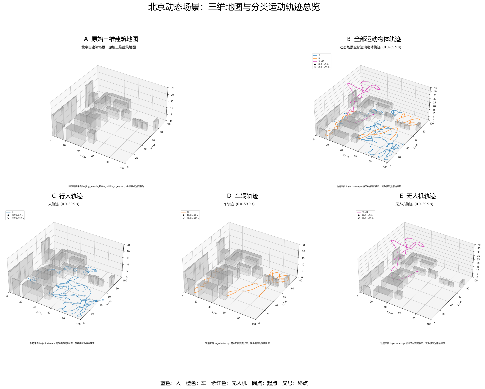

# 北京动态场景运动物体轨迹报告

本报告由 `dynamic_scene_dt0p1_large_objects/trajectories.npz` 的真实600帧轨迹生成。

## 1. 数据范围

- 时间：0.0–59.9 s。
- 时间步长：0.1 s。
- 帧数：600。
- 坐标：西南角为原点，x向东、y向北、z向上，单位为米。
- 图中圆点表示起点，叉号表示终点。
- 人为蓝色，车辆为橙色，无人机为紫红色。

## 2. 三维地图与轨迹总览

以下总图依次展示原始三维建筑、全部轨迹、行人轨迹、车辆轨迹和无人机轨迹。

## 3. 运动物体配置

### 人

- 数量：12。
- 尺寸：长 1.0 m × 宽 1.0 m × 高 2.0 m。
- 设定速度范围：0.4–1.8 m/s。
- 最大加速度：1.4 m/s²。
- 活动高度：0.0–0.0 m。

### 车

- 数量：3。
- 尺寸：长 3.0 m × 宽 2.0 m × 高 2.0 m。
- 设定速度范围：0.8–4.0 m/s。
- 最大加速度：1.8 m/s²。
- 活动高度：0.0–0.0 m。

### 无人机

- 数量：2。
- 尺寸：长 2.0 m × 宽 2.0 m × 高 2.0 m。
- 设定速度范围：0.5–4.0 m/s。
- 最大加速度：2.5 m/s²。
- 活动高度：20.0–40.0 m。

## 4. 每个物体从哪里到哪里、速度如何

| 物体 | 类别 | 起点 (x,y,z) | 终点 (x,y,z) | 最低速度 | 平均速度 | 最高速度 | 60秒路程 |
|---|---|---:|---:|---:|---:|---:|---:|
| human_000 | 人 | (85.95, 4.68, 0.00) m | (77.98, 18.98, 0.00) m | 0.30 m/s | 1.19 m/s | 1.80 m/s | 71.07 m |
| human_001 | 人 | (72.96, 11.68, 0.00) m | (97.56, 39.43, 0.00) m | 0.21 m/s | 1.16 m/s | 1.80 m/s | 69.40 m |
| human_002 | 人 | (2.79, 56.68, 0.00) m | (10.85, 37.20, 0.00) m | 0.06 m/s | 1.20 m/s | 1.80 m/s | 72.06 m |
| human_003 | 人 | (91.10, 28.35, 0.00) m | (43.52, 45.09, 0.00) m | 0.59 m/s | 1.32 m/s | 1.80 m/s | 79.14 m |
| human_004 | 人 | (63.63, 96.47, 0.00) m | (59.17, 86.70, 0.00) m | 0.31 m/s | 1.15 m/s | 1.80 m/s | 69.05 m |
| human_005 | 人 | (41.32, 79.72, 0.00) m | (12.66, 61.97, 0.00) m | 0.43 m/s | 1.20 m/s | 1.80 m/s | 71.66 m |
| human_006 | 人 | (69.16, 25.76, 0.00) m | (67.99, 15.26, 0.00) m | 0.38 m/s | 1.27 m/s | 1.80 m/s | 75.91 m |
| human_007 | 人 | (89.81, 23.08, 0.00) m | (92.16, 32.39, 0.00) m | 0.47 m/s | 1.30 m/s | 1.80 m/s | 77.68 m |
| human_008 | 人 | (48.49, 51.91, 0.00) m | (74.94, 35.29, 0.00) m | 0.29 m/s | 1.41 m/s | 1.80 m/s | 84.44 m |
| human_009 | 人 | (46.21, 50.00, 0.00) m | (83.85, 31.42, 0.00) m | 0.24 m/s | 1.22 m/s | 1.80 m/s | 72.94 m |
| human_010 | 人 | (27.78, 68.07, 0.00) m | (41.08, 81.46, 0.00) m | 0.27 m/s | 1.11 m/s | 1.80 m/s | 66.33 m |
| human_011 | 人 | (48.88, 58.24, 0.00) m | (44.90, 39.31, 0.00) m | 0.29 m/s | 1.32 m/s | 1.80 m/s | 79.28 m |
| car_000 | 车 | (14.02, 15.29, 0.00) m | (10.16, 25.17, 0.00) m | 1.13 m/s | 2.26 m/s | 4.00 m/s | 135.07 m |
| car_001 | 车 | (80.63, 40.14, 0.00) m | (61.70, 56.93, 0.00) m | 1.16 m/s | 2.04 m/s | 4.00 m/s | 121.92 m |
| car_002 | 车 | (67.30, 89.30, 0.00) m | (83.49, 81.71, 0.00) m | 0.71 m/s | 2.29 m/s | 3.71 m/s | 136.99 m |
| drone_000 | 无人机 | (24.74, 47.67, 29.13) m | (15.84, 52.23, 22.36) m | 0.93 m/s | 2.37 m/s | 3.83 m/s | 141.85 m |
| drone_001 | 无人机 | (59.82, 34.98, 29.81) m | (4.09, 95.47, 24.38) m | 0.96 m/s | 2.46 m/s | 4.00 m/s | 147.34 m |

## 5. 分类统计

| 类别 | 数量 | 实际平均速度 | 实际速度范围 | 平均路程 |
|---|---:|---:|---:|---:|
| 人 | 12 | 1.24 m/s | 0.06–1.80 m/s | 74.08 m |
| 车 | 3 | 2.19 m/s | 0.71–4.00 m/s | 131.33 m |
| 无人机 | 2 | 2.41 m/s | 0.93–4.00 m/s | 144.59 m |

## 6. 解释

- 起点和终点只是60秒时间窗的两端，物体在中间沿连续曲线运动，不代表直线行驶。
- 实际瞬时速度可能低于设定的目标速度下限，因为物体会在建筑、边界或其他物体附近减速避让。
- 行人和车辆在地面 `z=0` 运动；无人机在20–40 m高度范围内运动。
- 轨迹使用有界加速度更新，位置和速度连续，并通过建筑及物体碰撞检查。
